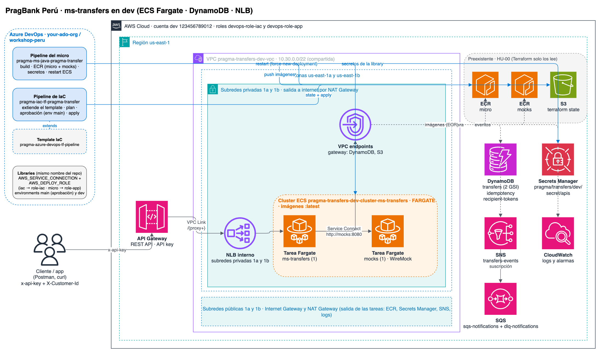

# pragma-iac-tf-pragma-transfer

Infraestructura como código (Terraform) de **ms-transfers** de PragBank Perú en AWS, ambiente **dev**, una sola zona de disponibilidad.

> **Estado: estructura base (HU-00).** No declara recursos todavía. La **HU-02** agrega los módulos de referencia de Pragma según `docs/arquitectura-dev.drawio`. El orden y las reglas están en el encabezado de `main.tf`.

---

## Arquitectura (HU-02)

Diagrama vigente: [`docs/arquitectura-dev.drawio`](docs/arquitectura-dev.drawio) (exportado en [`docs/arquitectura-dev.png`](docs/arquitectura-dev.png)).



- **Entrada:** API Gateway **REST API** con **API key** (`x-api-key`, usage plan) → VPC Link (v2) → **ALB interno** (no hay NLB). Recurso `/{proxy+}` (ANY), así los endpoints nuevos del micro no requieren cambios. No hay JWT.
- **Cómputo:** ECS con capacidad Fargate. Servicio `ms-transfers` (1 tarea) y servicio `mocks` (1 tarea, WireMock con los stubs del repo del micro, en Cloud Map como `mocks.pragbank.local:8080`). Las dos task definitions usan la imagen `:latest`.
- **Red:** VPC sin NAT Gateway. Subred privada en `us-east-1a` para las tareas y los VPC endpoints, y una segunda subred privada en `us-east-1b` solo para el ALB, que exige dos zonas. VPC endpoints gateway (DynamoDB, S3) e interface (ECR, Secrets Manager, SNS, CloudWatch Logs).
- **Datos:** DynamoDB on-demand, tablas `transfers` e `idempotency` (TTL).
- **Eventos:** SNS `transfers-events` → SQS `notifications` con DLQ.
- **Secretos:** Terraform crea el secreto vacío; el valor lo escribe el pipeline del micro. Nunca pasa por el state.
- **Preexistente (HU-00), solo con `data`:** los repositorios ECR `pragma-transfers-dev-ecr-ms-transfers` y `pragma-transfers-dev-ecr-mocks`, y el bucket del state `pragma-transfers-dev-workload-trf01-terraform-state`.

---

## Estructura del proyecto

```
pragma-iac-tf-pragma-transfer/
├── main.tf                          # Definición de módulos (HU-02)
├── variables.tf                     # Variables de entrada
├── outputs.tf                       # Outputs del stack
├── locals.tf                        # Valores locales y nomenclatura
├── data.tf                          # Data sources (cuenta, región, los dos ECR preexistentes)
├── providers.tf                     # Provider AWS (assume role), versiones y backend S3
├── environments/
│   └── dev/
│       ├── terraform.tfvars         # Variables de Terraform para dev (incluye common_tags)
│       └── .env.yaml                # Variables de pipeline (library + ENVIRONMENT)
├── templates/                       # Plantillas (task definitions, etc.)
├── docs/
│   └── arquitectura-dev.drawio       # Diagrama de la infraestructura
└── azure-pipelines.yaml             # Extiende el template corporativo de IaC
```

---

## Pipeline

Estrategia de despliegue completa (reparto con el pipeline del micro, acceso a AWS y orden la primera vez): [docs/deployment-strategy.md](docs/deployment-strategy.md).

`azure-pipelines.yaml` extiende el template corporativo `pragma-azure-devops-tf-pipeline` (`terraform/iac-pipeline.yml`), igual que `iac-sopp-prompt-as-a-service`. El template vive en el mismo proyecto (`workshop-peru/pragma-azure-devops-tf-pipeline`), así que no necesita service connection propia. Se dispara con push a la rama **`main`**, que carga `environments/dev/.env.yaml`.

| Etapa | Qué hace |
| --- | --- |
| Prerequisites | Extrae `common_tags` del tfvars, asume `AWS_DEPLOY_ROLE` y crea (o actualiza) el bucket del state con tags, versionado, cifrado y bloqueo público |
| CI | Instala Terraform, copia `environments/dev/terraform.tfvars` a la raíz, corre Checkov y publica el artefacto |
| Validation | `init` (backend S3 con `use_lockfile`), `fmt -check`, `validate` y `plan` |
| Approval | Espera la aprobación del environment **`main`** (el template usa el nombre de la rama) |
| CD | `apply` con el tfvars del ambiente |

El bucket del state se llama `$(CLIENT)-$(PROJECT)-$(ENVIRONMENT)-$(INFRASTRUCTURE)-$(CODE_APP)-terraform-state`. Con la library de abajo es `pragma-transfers-dev-workload-trf01-terraform-state`, que ya existe (HU-00); Prerequisites solo actualiza sus tags.

### Requisitos en Azure DevOps

- **Service connection de AWS** (`aws-service-connection-dev`, rol `pragma-workshop-peru-devops-role-dev-deploy`): puede asumir `pragma-workshop-peru-devops-role-iac`, que es el `AWS_DEPLOY_ROLE` de este pipeline. Su nombre va en la library, no en el YAML.
- **Environment `main`** (el template lo nombra igual que la rama) con la aprobación configurada en *Approvals and checks*.
- Autorizar al pipeline el acceso al repo `pragma-azure-devops-tf-pipeline`, la library y la service connection la primera vez que corra.
- **Library `pragma-iac-tf-pragma-transfer`** con las variables de abajo.

### Library `pragma-iac-tf-pragma-transfer`

| Variable | Ejemplo | Para qué |
| --- | --- | --- |
| `AWS_SERVICE_CONNECTION` | `aws-service-connection-dev` | Service connection de AWS que usan las tareas |
| `AWS_DEPLOY_ROLE` | `arn:aws:iam::123456789012:role/pragma-workshop-peru-devops-role-iac` | Rol que asume Terraform (provider y backend) |
| `AWS_REGION` | `us-east-1` | Región del despliegue y del bucket del state |
| `CLIENT` | `pragma` | Nombre del bucket del state |
| `PROJECT` | `transfers` | Nombre del bucket del state |
| `INFRASTRUCTURE` | `workload` | Nombre del bucket y de la llave del state |
| `CODE_APP` | `trf01` | Nombre del bucket del state (máx. 5 caracteres) |
| `TERRAFORM_VERSION` | `1.14.0` | Versión que instala el pipeline (mínimo 1.14 por `providers.tf`) |

`ENVIRONMENT` no va en la library: lo define `environments/dev/.env.yaml`. Las variables de Terraform van en `environments/dev/terraform.tfvars`. Esta library no tiene secretos.

## Requisitos del código Terraform (HU-02)

- Solo módulos de referencia de Pragma (`somospragma/cloudops-ref-repo-aws-*-terraform`), con `providers = { aws.project = aws.principal }`.
- Nomenclatura `{client}-{project}-{environment}-{type}-{key}` (`local.name_prefix`).
- Task definitions del micro y de mocks con la imagen `:latest`: el pipeline del micro sube las dos imágenes y reinicia las tareas; no registra revisiones.
- Secreto de Secrets Manager sin `aws_secretsmanager_secret_version`: Terraform crea el secreto vacío y el pipeline del micro escribe el valor.
- ECR del micro y de mocks con `data` sources (`ecr_repository_name`, `ecr_mocks_repository_name`), nunca como `resource`.
- Outputs: `ecs_cluster_name`, `ecs_service_name`, `ecs_mocks_service_name`, `secret_apis_name`, `api_base_url` y `api_key_id` (estos dos últimos para probar el API).

### Después del primer apply

Copiar a la library `pragma-ms-java-pragma-transfer`:

| Variable de la library | Output de Terraform |
| --- | --- |
| `ECS_CLUSTER` | `ecs_cluster_name` |
| `ECS_SERVICE` | `ecs_service_name` |
| `ECS_MOCKS_SERVICE` | `ecs_mocks_service_name` |
| `SECRET_APIS_NAME` | `secret_apis_name` |

## Requisitos locales

| Herramienta | Versión | Verificar |
| --- | --- | --- |
| Git + llave SSH registrada en `dev.azure.com/your-ado-org` | — | `git clone git@ssh.dev.azure.com:v3/your-ado-org/workshop-peru/pragma-iac-tf-pragma-transfer` |
| Terraform | 1.14.x | `terraform -version` |
| AWS CLI v2 con acceso a la cuenta `123456789012` (SSO) | 2.x | `aws sts get-caller-identity` |
| Acceso en Azure DevOps a la library `pragma-ms-java-pragma-transfer` (editar) y aprobador del environment `main` | — | Abrir *Pipelines → Library* |

## Validar en local

```bash
terraform fmt -check -recursive
terraform init -backend=false
terraform validate
```
