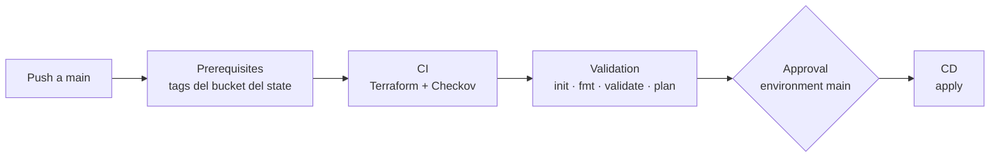

# Estrategia de despliegue · infraestructura de ms-transfers (dev)

Cómo se crea y cambia la infraestructura de `dev`, y cómo se reparte el trabajo con el pipeline del micro. Diagrama: [`arquitectura-dev.drawio`](arquitectura-dev.drawio) ([PNG](arquitectura-dev.png)).

## Reparto de responsabilidades

| Qué | Quién |
| --- | --- |
| ECR del micro y de mocks, bucket del state, rol de deploy, service connection | **HU-00** (preexistentes; Terraform solo lee los ECR con `data`) |
| Red, NLB, API Gateway, cluster ECS, servicios y task definitions del micro y de mocks, DynamoDB, SNS/SQS, secreto vacío, IAM, CloudWatch | **Este repo** (Terraform) |
| Imágenes `:latest`, valor de los secretos, reinicio de tareas | **Pipeline del micro** (`pragma-ms-java-pragma-transfer`) |

Las task definitions apuntan siempre a `:latest`. Terraform no cambia imágenes y el pipeline del micro no registra revisiones: cada uno toca lo suyo y no se pisan.

## Pipeline (`azure-pipelines.yaml`)

Extiende el template corporativo `workshop-peru/pragma-azure-devops-tf-pipeline` (igual que `iac-sopp-prompt-as-a-service`). Se dispara con push a `main`, que carga `environments/dev/.env.yaml` (library `pragma-iac-tf-pragma-transfer` + `ENVIRONMENT=dev`).

| Stage | Qué hace |
| --- | --- |
| Prerequisites | Lee `common_tags` de `environments/dev/terraform.tfvars`, asume `AWS_DEPLOY_ROLE` y crea o actualiza el bucket `pragma-transfers-dev-workload-trf01-terraform-state` |
| CI | Instala `TERRAFORM_VERSION`, copia el tfvars del ambiente a la raíz, corre Checkov (soft fail) y publica el artefacto |
| Validation | `init` con backend S3 y `use_lockfile`, `fmt -check`, `validate` y `plan` con `deploy_role_arn` |
| Approval | Espera la aprobación del environment **`main`** (el template lo nombra igual que la rama) |
| CD | `apply` con el tfvars del ambiente |

## Acceso a AWS (sin llaves)

- Las tareas usan la service connection `$(AWS_SERVICE_CONNECTION)` (OIDC).
- Terraform asume `$(AWS_DEPLOY_ROLE)` en el provider (`assume_role { role_arn = var.deploy_role_arn }`) y en el backend.
- Cadena de roles: la service connection usa `pragma-workshop-peru-devops-role-dev-deploy`, que solo puede asumir `pragma-workshop-peru-devops-role-iac` (este pipeline) y `pragma-workshop-peru-devops-role-app` (pipeline del micro). `AWS_DEPLOY_ROLE` de esta library es el ARN de `role-iac`.

## Dónde va cada valor

| Valor | Dónde |
| --- | --- |
| Service connection, rol, región, `CLIENT`, `PROJECT`, `INFRASTRUCTURE`, `CODE_APP`, `TERRAFORM_VERSION` | Library `pragma-iac-tf-pragma-transfer` |
| `ENVIRONMENT` | `environments/dev/.env.yaml` |
| Variables de Terraform (red, ECR, tareas, API Gateway, tags) | `environments/dev/terraform.tfvars` |

## Después de cada apply que cambie nombres

Copiar a la library `pragma-ms-java-pragma-transfer`:

| Variable | Output |
| --- | --- |
| `ECS_CLUSTER` | `ecs_cluster_name` |
| `ECS_SERVICE` | `ecs_service_name` |
| `ECS_MOCKS_SERVICE` | `ecs_mocks_service_name` |
| `SECRET_APIS_NAME` | `secret_apis_name` |

## Orden la primera vez

1. HU-00 lista (ECR, bucket, roles `role-iac` y `role-app` con sus permisos, libraries, environments `main` y `dev`).
2. Correr este pipeline y aprobar en `main`. Las tareas de ECS fallan hasta que existan las imágenes `:latest`; es esperado.
3. Copiar los outputs a la library del micro.
4. Correr el pipeline del micro: sube las imágenes y reinicia las tareas.
